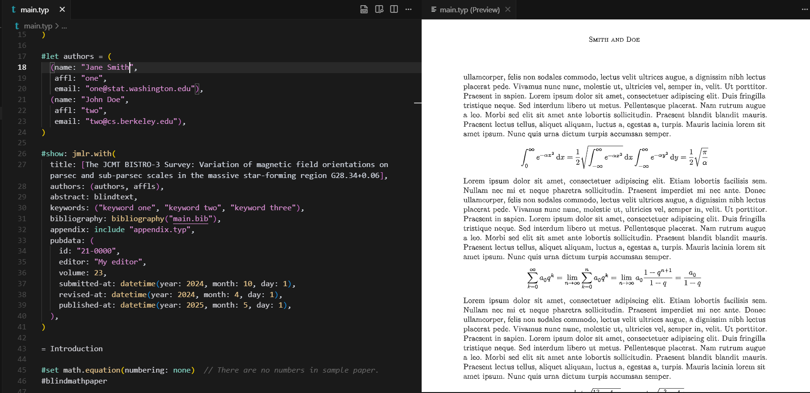

# Typst + Pandoc Dev Container

[](https://codespaces.new/1solomonwakhungu/typst-dev-container)
[](https://github.com/1solomonwakhungu/typst-dev-container/actions/workflows/containers.yaml)
[](./LICENSE)
[](https://skills.sh/1solomonwakhungu/typst-dev-container)

**Prebuilt, multi-architecture Dev Container image and OCI template with pinned Typst, Pandoc, and Tinymist — ~132 MB compressed on `debian:trixie-slim`, plus an optional `:rust` variant.**  
Keep PDF builds identical across macOS, Linux, Windows, GitHub Codespaces, and CI — even across Typst releases.

[Documentation & Version Matrix](https://typst.harlo.dev) · [Container Image (`ghcr.io`)](https://github.com/1solomonwakhungu/typst-dev-container/pkgs/container/typst-dev-container%2Ftypst) · [Dev Container Template](./src/typst/README.md)



---

## Why Use This Container?

Installing Typst locally is fast — until a team, thesis co-author, or CI runner runs a different Typst release, lacks Pandoc for LaTeX/Markdown conversion, or needs a zero-install browser workspace.

This project ships:
- **Lightweight `debian:trixie-slim` default (~132 MB compressed)** — ~80% smaller than the Rust base image for fast pulls, with an optional **`:rust` variant** (`:rust`, `:<version>-rust`) when you need `rustc` and `cargo` for Typst plugins or Rust development.
- **Prebuilt multi-arch images** (`linux/amd64` and `linux/arm64`) on GHCR — pull and start, no local Dockerfile build.
- **3 pinned Typst releases simultaneously** — lock a paper or CI job to an exact tag (`0.14.2`, `0.15.0`, `0.15.1`) or track `latest`.
- **Pandoc preinstalled** — convert LaTeX, Markdown, or Word documents into Typst inside the same environment.
- **VS Code ready out of the box** — preconfigured with **Tinymist** (`myriad-dreamin.tinymist`, `typstyle` format-on-save), **Pandoc Assist**, **Rewrap**, and **Trailing Spaces**.
- **Automated weekly upkeep** — a scheduled GitHub Action verifies upstream Typst, Pandoc, and Rust artifacts exist before opening a smoke-tested update PR.

---

## Quick Start

Choose how you want to use it:

### 1. Add to an Existing Project (Recommended)

Apply the published [Dev Container Template](./src/typst/README.md) with the Dev Container CLI:

```bash
devcontainer templates apply \
  --template-id ghcr.io/1solomonwakhungu/typst-dev-container/templates/typst \
  --template-args '{"typstVersion": "latest"}'
```

Or in VS Code: run **Dev Containers: Add Dev Container Configuration Files...** → **Show All Definitions** → search `ghcr.io/1solomonwakhungu/typst-dev-container/templates/typst`.

Or drop this minimal `.devcontainer/devcontainer.json` into any repository:

```json
{
  "name": "Typst + Pandoc",
  "image": "ghcr.io/1solomonwakhungu/typst-dev-container/typst:latest",
  "customizations": {
    "vscode": {
      "extensions": ["myriad-dreamin.tinymist"]
    }
  }
}
```

Then press <kbd>F1</kbd> → **Dev Containers: Reopen in Container**.

### 2. Try Instantly in GitHub Codespaces (No Local Docker)

Click the button below or run `gh codespace create --repo 1solomonwakhungu/typst-dev-container`:

[](https://codespaces.new/1solomonwakhungu/typst-dev-container)

### 3. Run Directly with Docker / CI (No Editor Needed)

The image sets `WORKDIR /workspace`, so mount your document directory directly:

```bash
docker run --rm -v "$PWD":/workspace \
  ghcr.io/1solomonwakhungu/typst-dev-container/typst:latest \
  typst compile hello.typ
```

Swap `:latest` for a pinned version tag (e.g., `:0.15.1` or `:0.14.2`) for reproducible CI builds.

---

## Included Versions

This container bundles:
<!-- toolchain-versions:start -->
- **Typst**: 0.15.1 (`latest`, `slim`), 0.15.0, 0.14.2
- **Pandoc**: 3.14
- **Base images**: `debian:trixie-slim` (default / `:slim`) and `rust:1.100.0` (`:rust` variant, Debian 13 trixie)
<!-- toolchain-versions:end -->

Each Typst release is published as its own multi-arch (`linux/amd64`, `linux/arm64`) tag on GHCR in both slim Debian (default) and Rust variants, for example:

```text
# Slim Debian default (~132 MB compressed)
ghcr.io/1solomonwakhungu/typst-dev-container/typst:latest
ghcr.io/1solomonwakhungu/typst-dev-container/typst:slim
ghcr.io/1solomonwakhungu/typst-dev-container/typst:0.15.1
ghcr.io/1solomonwakhungu/typst-dev-container/typst:0.15.0
ghcr.io/1solomonwakhungu/typst-dev-container/typst:0.14.2

# Rust toolchain variant (~667 MB compressed, adds rustc & cargo)
ghcr.io/1solomonwakhungu/typst-dev-container/typst:rust
ghcr.io/1solomonwakhungu/typst-dev-container/typst:0.15.1-rust
```

> The version list above is automatically updated by [`.github/scripts/update-toolchain.py`](./.github/scripts/update-toolchain.py) to stay in sync with [`images/typst/docker-bake.hcl`](./images/typst/docker-bake.hcl).

### Preconfigured VS Code Extensions (Template)

| Extension | Purpose |
|---|---|
| `myriad-dreamin.tinymist` | Typst language server, live preview, and `typstyle` format-on-save |
| `FreddyZhu.pandoc-assist` | Pandoc conversion helper inside VS Code |
| `stkb.rewrap` | Rewrap prose and comments |
| `shardulm94.trailing-spaces` | Highlight trailing whitespace |

The template also sets `files.eol` to `\n`, associates `*.typ` with `typst`, and enables `editor.formatOnSave` using `tinymist.formatterMode: "typstyle"`.

---

## Everyday Commands

### Typst → PDF

Create `hello.typ`:

```typst
#set text(size: 11pt)
#set page(
  paper: "us-letter",
  margin: (x: 1.5in, y: 1in),
)

= Hello, Typst!

Write modern markup and compile reproducible PDFs on any machine.
```

Compile once or watch for changes:

```bash
# One-time compile
typst compile hello.typ hello.pdf

# Watch and recompile on save
typst watch hello.typ hello.pdf
```

### Convert Existing Documents with Pandoc

```bash
# LaTeX to Typst
pandoc article.tex -o article.typ

# Markdown to editable Typst, then compile to PDF
pandoc input.md --to typst --output output.typ
typst compile output.typ

# Markdown directly to PDF via Typst
pandoc README.md -o README.pdf --pdf-engine=typst

# Word (.docx) to Markdown
pandoc document.docx -o document.md
```

> **Note:** Review converted `.typ` files after running Pandoc — complex LaTeX macros and custom layouts may need manual adjustments.

### Verify the Toolchain

```bash
typst --version
pandoc --version
git --version
# On :rust tags, also: rustc --version
```

---

## How Versions Stay Current

- **Weekly check:** Every Monday, [`.github/workflows/update-toolchain.yaml`](./.github/workflows/update-toolchain.yaml) checks the 3 newest stable Typst releases plus Rust and Pandoc, adopting a version only after upstream binaries and Docker base tags are published.
- **PR smoke tests:** [`.github/workflows/test-pr.yaml`](./.github/workflows/test-pr.yaml) builds the candidate image from the PR and verifies `typst` and `pandoc` inside the template before merge.
- **Automated publish:** Merges to `main` publish multi-arch images via [`containers.yaml`](./.github/workflows/containers.yaml) and the OCI template via [`release.yaml`](./.github/workflows/release.yaml).

---

## Prerequisites & Troubleshooting

**Prerequisites for local use:** VS Code (or compatible editor like VS Codium / Cursor), the [Dev Containers extension](https://marketplace.visualstudio.com/items?itemName=ms-vscode-remote.remote-containers), and Docker (Docker Desktop, WSL 2, or Docker Engine). No local setup is needed for GitHub Codespaces.

<details>
<summary><strong>First pull size &amp; disk space</strong></summary>

The default `debian:trixie-slim` image (`:latest`, `:slim`, `:<version>`) pulls ~132–135 MB compressed (~565–600 MB on disk depending on platform). The optional `:rust` variant (`:rust`, `:<version>-rust`) pulls ~624–667 MB compressed (~2.5–2.6 GB on disk). Subsequent starts reuse the local image cache.

</details>

<details>
<summary><strong><code>typst</code> or <code>pandoc</code> command not found</strong></summary>

Your terminal is likely running on the host rather than inside the container. Check that the bottom-left corner of VS Code shows **Dev Container**; if not, run **Dev Containers: Reopen in Container**.

</details>

<details>
<summary><strong>Container fails to start or pull</strong></summary>

Ensure Docker is running and test pulling the image directly:

```bash
docker pull ghcr.io/1solomonwakhungu/typst-dev-container/typst:latest
```

In VS Code, check the **Remote** output panel for detailed logs.

</details>

<details>
<summary><strong>Container user (<code>remoteUser</code>)</strong></summary>

The template runs as `root` by default. Remove the `"remoteUser": "root"` line from your generated `.devcontainer/devcontainer.json` if you prefer a non-root user.

</details>

---

## Agent Skills

This repository publishes two skills for coding agents via [skills.sh](https://skills.sh/1solomonwakhungu/typst-dev-container):

- [`typst-devcontainer-pandoc-setup`](./skills/typst-devcontainer-pandoc-setup/SKILL.md) — sets up and verifies containerized Typst + Pandoc workspaces, converts documents with Pandoc, and compiles Typst to PDF.
- [`typst-toolchain-version-updater`](./skills/typst-toolchain-version-updater/SKILL.md) — updates the buildable Typst, Rust, and Pandoc version matrix and publishing workflows in this repository.

```bash
npx skills add https://github.com/1solomonwakhungu/typst-dev-container --skill typst-devcontainer-pandoc-setup
npx skills add https://github.com/1solomonwakhungu/typst-dev-container --skill typst-toolchain-version-updater
```

---

## Contributing & License

Found a bug or want to suggest an improvement? [Open an issue](https://github.com/1solomonwakhungu/typst-dev-container/issues) or see [CONTRIBUTING.md](./CONTRIBUTING.md) for local build and smoke-test instructions.

Released under the [MIT License](./LICENSE).
